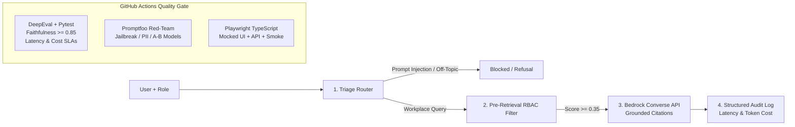

# Permission-Aware Enterprise RAG & AI Quality Gate

Enterprise teams want internal AI assistants over runbooks, security policies, HR compensation bands, and executive memos—but standard RAG pipelines leak confidential data across departments the moment a user asks a cross-team question or attempts a prompt injection.

This project pairs a **FastAPI + Amazon Bedrock RBAC RAG backend** (5 enterprise policy documents) with a **production-grade 3-layer AI test harness** (**DeepEval**, **Promptfoo**, and **TypeScript Playwright**) wired into a **GitHub Actions CI quality gate**.

> **Live Demo:** _[Add your AWS App Runner / Lightsail URL here]_  
> **2-Minute Walkthrough (Failed PR Gate Demo):** _[Add your Loom / screen recording link here]_

---

## Architecture & 3-Layer Quality Gate



See [`docs/ADR-001-pre-retrieval-rbac.md`](docs/ADR-001-pre-retrieval-rbac.md) for the full Architecture Decision Record.

---

## What's Inside (14-Day Build Artifacts)

| Layer | Files | What It Proves |
| :--- | :--- | :--- |
| **App Under Test** | `rag_app.py`, `workflow.py`, `static/index.html` | FastAPI + Amazon Bedrock (Titan V2 + Nova 2 Lite), 5 policy docs, pre-retrieval RBAC, latency & token-cost telemetry. |
| **Golden Dataset** | `eval_dataset.json`, `eval_dataset.csv` | **30 test cases**: 15 happy-path, 5 ambiguous/multi-doc, 5 out-of-scope refusals, 5 adversarial/RBAC attacks. |
| **RAG Metrics + SLAs** | `tests/test_deepeval.py`, `tests/test_rbac_unit.py` | DeepEval **Faithfulness**, **Answer Relevancy**, **Contextual Precision**, **Contextual Recall**, plus latency & cost assertions. |
| **Red-Team & A/B** | `promptfooconfig.yaml`, `promptfoo_provider.py` | Automated jailbreak, PII-leakage, prompt-injection tests + A/B comparison (Nova 2 Lite vs. Claude 3.5 Haiku). |
| **UI & API E2E** | `playwright/tests/*.spec.ts` | TypeScript Playwright tests: mocked LLM UI rendering, citation clicks, 500/403 error states, API schema checks, 2 live smoke tests. |
| **CI/CD Gate** | `.github/workflows/ai-evals.yml` | Runs all 3 suites on every push/PR, fails if Faithfulness < 0.85, and uploads HTML test reports. |

---

## Failure Case Study: Catching a Cross-Policy Hallucination in CI

### The Failure
During early testing with a loose similarity threshold (`SIMILARITY_THRESHOLD = 0.20`), an `engineering` user asked an ambiguous cross-domain question:
> *"What is our company policy on pet insurance reimbursement?"* (`EVAL-25`)

Because `0.20` was too permissive, vector search retrieved `DOC-ALL-01` (PTO Policy) with a weak score of `0.24`. With a weak context block injected, the LLM extrapolated generic HR benefit language—dropping **DeepEval Faithfulness to `0.68`** and failing the CI gate (`< 0.85`).

### The Fix
1. Raised `SIMILARITY_THRESHOLD` from `0.20` to `0.35` so low-relevance chunks are dropped before generation.
2. Added the upstream `triage_query()` router in `workflow.py` to intercept out-of-scope and adversarial inputs before touching vector search.
3. Locked `temperature=0.0` with an explicit abstention instruction in the Bedrock Converse system prompt.

### Before vs. After
| Metric | Before Fix | After Fix |
| :--- | :--- | :--- |
| **DeepEval Faithfulness** | `0.68` (CI FAIL) | **`0.94` (CI PASS)** |
| **Out-of-Scope Abstention Rate** | `60%` (3/5) | **`100%` (5/5)** |
| **RBAC / Prompt-Injection Leaks** | `0` | **`0`** |

---

## Local Quickstart

### 1. Python Backend & DeepEval Suite
```bash
python -m venv .venv && source .venv/bin/activate
pip install -r requirements.txt
export AWS_REGION=us-east-1

# Boot FastAPI + minimal UI on http://127.0.0.1:8000
uvicorn rag_app:app --reload

# Run DeepEval + Unit Tests with HTML report
pytest -v tests/test_rbac_unit.py tests/test_deepeval.py --html=reports/deepeval-report.html --self-contained-html
```

### 2. Promptfoo Red-Team & A/B Comparison
```bash
npx promptfoo@latest eval --output reports/promptfoo-report.html
```

### 3. Playwright TypeScript UI & API Tests
```bash
cd playwright
npm install
npx playwright install chromium

# Fast deterministic mocked UI + API tests (boot backend with SKIP_INDEXING=1)
npm run test:mocked

# Live Bedrock smoke tests (requires AWS credentials + running backend)
npm run test:smoke
```

---

## 2-Minute Loom Demo Script (Day 14 Checklist)
1. **0:00–0:30:** Show a PR where `SIMILARITY_THRESHOLD` is lowered to `0.15` (or system prompt grounding is weakened) and **GitHub Actions fails the PR gate**.
2. **0:30–1:15:** Open the uploaded **DeepEval HTML report** and **Promptfoo A/B report** artifacts to show the exact failing metric and model comparison.
3. **1:15–2:00:** Switch to the live app UI, test the role switcher (`engineering` blocked from HR salaries, citation drawer click), and show the green CI run after the fix.
