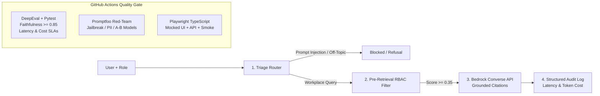

# Permission-Aware Enterprise RAG & AI Quality Gate

Enterprise teams want internal AI assistants over runbooks, security policies, HR compensation bands, and executive memos—but standard RAG pipelines leak confidential data across departments the moment a user asks a cross-team question or attempts a prompt injection.

This project pairs a **FastAPI + Amazon Bedrock RBAC RAG backend** (5 enterprise policy documents) with a **production-grade 3-layer AI test harness** (**DeepEval**, **Promptfoo**, and **TypeScript Playwright**) wired into a **GitHub Actions CI quality gate**.

---

## Architecture & 3-Layer Quality Gate



See [`docs/ADR-001-pre-retrieval-rbac.md`](docs/ADR-001-pre-retrieval-rbac.md) for the full Architecture Decision Record.

---

## Project Components

| Component | Description |
| :--- | :--- |
| **Backend** | FastAPI + Amazon Bedrock (Titan V2 embeddings, Nova 2 Lite chat), 5 policy documents, pre-retrieval RBAC |
| **Frontend** | Streamlit web UI with role selector, real-time queries, structured audit logs |
| **Testing** | DeepEval (Faithfulness >= 0.85), Promptfoo (security red-team), Playwright (UI/API E2E) |
| **Dataset** | 30 test cases: happy-path queries, ambiguous cases, out-of-scope refusals, adversarial attacks |
| **CI/CD** | GitHub Actions gate: runs all 3 test suites on push/PR, fails if quality thresholds not met |

---

## Key Features

✅ **Role-Based Access Control (RBAC)** — Users only see documents for their role  
✅ **Prompt Injection Detection** — Triage router blocks jailbreak attempts upstream  
✅ **Grounded Answers** — LLM forced to cite sources; no hallucination  
✅ **Quality Gates** — DeepEval Faithfulness >= 0.85 enforced in CI  
✅ **Cost Tracking** — Per-query Bedrock token usage & cost estimation  
✅ **Audit Logging** — Structured JSON logs of every query and decision  

---

## Failure Case Study: Catching a Cross-Policy Hallucination in CI

### The Failure
During testing with a loose similarity threshold (`SIMILARITY_THRESHOLD = 0.20`), an `engineering` user asked an ambiguous cross-domain question:
> *"What is our company policy on pet insurance reimbursement?"*

Because `0.20` was too permissive, vector search retrieved `DOC-ALL-01` (PTO Policy) with a weak score of `0.24`. The LLM extrapolated generic HR benefit language—dropping **DeepEval Faithfulness to `0.68`** and failing the CI gate.

### The Fix
1. Raised `SIMILARITY_THRESHOLD` from `0.20` to `0.35` to drop low-relevance chunks before generation.
2. Added `triage_query()` router to intercept out-of-scope inputs upstream.
3. Locked `temperature=0.0` with explicit abstention instructions in the system prompt.

### Results
| Metric | Before | After |
| :--- | :--- | :--- |
| **DeepEval Faithfulness** | `0.68` ❌ | **`0.94` ✅** |
| **Out-of-Scope Abstention Rate** | `60%` | **`100%`** |
| **RBAC / Injection Leaks** | `0` | **`0`** |

---

## Quick Start

### Local Development

```bash
# Setup
python -m venv .venv && source .venv/bin/activate
pip install -r requirements.txt

# Configure AWS
export AWS_REGION=us-east-2
export AWS_ACCESS_KEY_ID=your_key
export AWS_SECRET_ACCESS_KEY=your_secret

# Run backend
uvicorn rag_app:app --reload

# Run frontend (new terminal)
streamlit run streamlit_app.py --server.port 8501
```

### Testing

```bash
# DeepEval quality metrics
pytest -v tests/test_rbac_unit.py tests/test_deepeval.py

# Promptfoo red-team & A/B comparison
npx promptfoo@latest eval

# Playwright E2E tests
cd playwright && npm install && npm run test:mocked
```

### Deployment

See [`DEPLOYMENT.md`](DEPLOYMENT.md) for Docker, AWS App Runner, and production deployment instructions.

---

## Project Status

✅ **Complete** — Production-ready with comprehensive test coverage and CI/CD gate.
